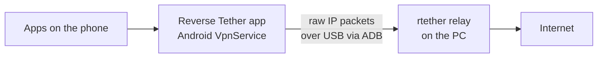

# Reverse Tether

Give an Android phone internet from a Windows PC over the USB cable that already
charges it. Normal USB tethering runs phone to PC. This runs PC to phone. No root needed.

One phone on the cable can also share that internet with other phones over its Wi-Fi
hotspot.

## How it works



- `android/` is a small Kotlin app. Its VpnService captures the phone's traffic and
  copies the raw packets to the PC over a port that ADB forwards through the cable.
- `relay/` is a Python program on the PC. It turns those packets into real TCP and UDP
  connections, fetches the answers, and sends them back.

## Features

- Internet for the phone over a plain USB cable, with no root and no drivers.
- Hub mode: the phone on USB shares the link with up to 8 other phones over its hotspot.
- The hub phone shows a QR code that other phones scan to download the app, no PC needed.
- Reconnects on its own when the cable is unplugged and plugged back in.
- The relay is pure Python with no third-party dependencies.

## Requirements

- A Windows PC with [Python 3.12+](https://www.python.org/downloads/) and
  [uv](https://docs.astral.sh/uv/).
- An Android phone running Android 7.0 or later.
- A USB cable that carries data.

## Quick start

### 1. Prepare the phone (once)

1. Settings > About phone > tap "Build number" 7 times.
2. Settings > System > Developer options > turn on **USB debugging**.
3. Plug in the cable, choose "File transfer" if asked, tick "Always allow" and tap
   "Allow" on the USB debugging prompt.

### 2. Get the app

Download `rtether.apk` from the
[latest release](https://github.com/Utsab0803/reverse_tether/releases/latest).

### 3. Set up the PC (once)

```
git clone https://github.com/Utsab0803/reverse_tether.git
cd reverse_tether/relay
uv sync
uv run rtether setup                              # downloads Google's adb
uv run rtether devices                            # should say "Phone ready: <serial>"
uv run rtether install --apk <path to rtether.apk>
```

### 4. Share internet

```
uv run rtether run
```

The first time, open **Reverse Tether** on the phone, press **Start**, and tap **OK** on
the VPN dialog. After that, `rtether run` is all that is needed.

## Daily use

Plug the phone in, then:

```
cd relay
uv run rtether run
```

A key icon appears in the phone's status bar while it is sharing. Ctrl+C stops it and
removes the icon.

| Option | What it does |
|---|---|
| `--verbose` | Prints flow counts every 10 seconds. |
| `--dns 8.8.8.8` | Overrides the DNS server (default: the one the PC uses). |
| `--port <n>` | Changes the relay port (default 31416). |
| `--serial <id>` | Picks a phone when more than one is plugged in. |

## Share with other phones (hub mode)

Android's own hotspot cannot forward a VPN, so the app does the routing itself. The phone
on USB becomes the hub; other phones join its hotspot and run the same app.

On the hub phone (the one on USB):

1. Start the USB link as usual (`uv run rtether run` on the PC).
2. Turn the Wi-Fi hotspot on in Settings. Also turn **off** "turn off hotspot
   automatically" so it survives idle time.
3. In Reverse Tether, switch on **Share over my Wi-Fi hotspot**. The screen shows the hub
   address (for example `10.79.54.103:31417`), a QR code for the app download, and how
   many phones are connected. The address changes each time the hotspot is restarted.

On each other phone:

1. Join the hub phone's hotspot. It will say "no internet"; that is expected.
2. Get the app: scan the QR code on the hub's screen and tap Download on the page that
   opens. (Or download `rtether.apk` from the releases page beforehand.)
3. Open Reverse Tether. "Hub phone address" is already filled in. Tap
   **Connect to phone hub**, and tap OK on the VPN dialog the first time. If the app was
   opened on ordinary Wi-Fi, the field holds that router's address; replace it with the
   one on the hub's screen.
4. If the phone has mobile data, Android may prefer it over the no-internet hotspot and
   drop the Wi-Fi. Turn mobile data off while using the hub.

While a phone is connected to the hub, the `:31418` download link does not open on it,
because its traffic goes through the tunnel. Stop the app to reach the link again.

## See who is connected

```
uv run rtether phones
```

lists every phone on a USB cable and, for a phone whose hotspot is on, every phone joined
to that hotspot:

```
USB phones
  LFEESKEUAYKRFYS4  RMX3392  Android 14  app installed  hotspot on 10.79.54.103
Install the app on one:  uv run rtether install --serial <serial>   (or --all)

Phones on RMX3392's hotspot (10.79.54.103)
  10.79.54.27   aa:bb:cc:dd:ee:ff   reachable
Give them the app: open  http://10.79.54.103:31418  on their phone (sharing must be on)
```

`uv run rtether install --all` installs the app on every ready USB phone. Hotspot entries
can stay listed as `stale` for about a minute after a phone leaves.

## Limits

- IPv4 only. Sites that are IPv6-only will not load.
- One phone on USB at a time. Plugging in a second replaces the first.
- Android allows one VPN at a time, so other VPN apps must be off.
- Hub mode: up to 8 phones, all sharing one USB link. Fine for browsing and chat.
- The phone can reach anything the PC can reach on its network, but not services bound
  to the PC's own loopback address.
- When the VPN is the phone's only network (no SIM service, Wi-Fi off), Android marks the
  status bar with a no-network cross and some apps (Facebook, YouTube, Play Store) show
  "No connection" banners from their own checks, even while their data flows through the
  tunnel. Browsers, WhatsApp and most apps are unaffected. Workaround: have any SIM
  registered or any Wi-Fi joined, even one without internet.

## Build the app from source

Only needed to change the app; otherwise use the release APK. Docker Desktop must be
running. No Java or Android SDK is needed on the PC.

The build signs the APK with a keystore at `android/keystore/rtether.keystore`, which is
not in the repo. Create your own once:

```
docker run --rm -v "${PWD}/android/keystore:/k" gradle:8.7-jdk17 keytool -genkeypair -keystore /k/rtether.keystore -alias rtether -storepass android -keypass android -keyalg RSA -keysize 2048 -validity 10000 -dname "CN=Reverse Tether"
```

Then build:

```
docker build -f docker/Dockerfile.android -o dist android/
```

The first build downloads the Android SDK and takes several minutes. The result is
`dist/rtether.apk`, which `uv run rtether install` picks up by default.

An APK signed with a different keystore will not install over an existing copy of the
app; uninstall the old one first.

## Publishing a release (maintainers)

Pushing a version tag makes GitHub Actions build the APK and attach it to a new release
(`.github/workflows/release.yml`).

One-time setup: add the signing keystore as the repository secret `KEYSTORE_BASE64`
(Settings > Secrets and variables > Actions). In PowerShell this copies the value:

```
[Convert]::ToBase64String([IO.File]::ReadAllBytes("$PWD\android\keystore\rtether.keystore")) | Set-Clipboard
```

Always release with the same keystore, and keep a backup of it; otherwise every phone has
to uninstall the app before it can update.

To release, set `versionCode` and `versionName` in `android/app/build.gradle.kts`, commit,
then push a tag with the same version:

```
git tag vX.Y.Z
git push origin main vX.Y.Z
```

## Development

```
cd relay
uv run pytest        # no phone or Docker needed
uv run ruff check .
```

## License

[MIT](LICENSE)
